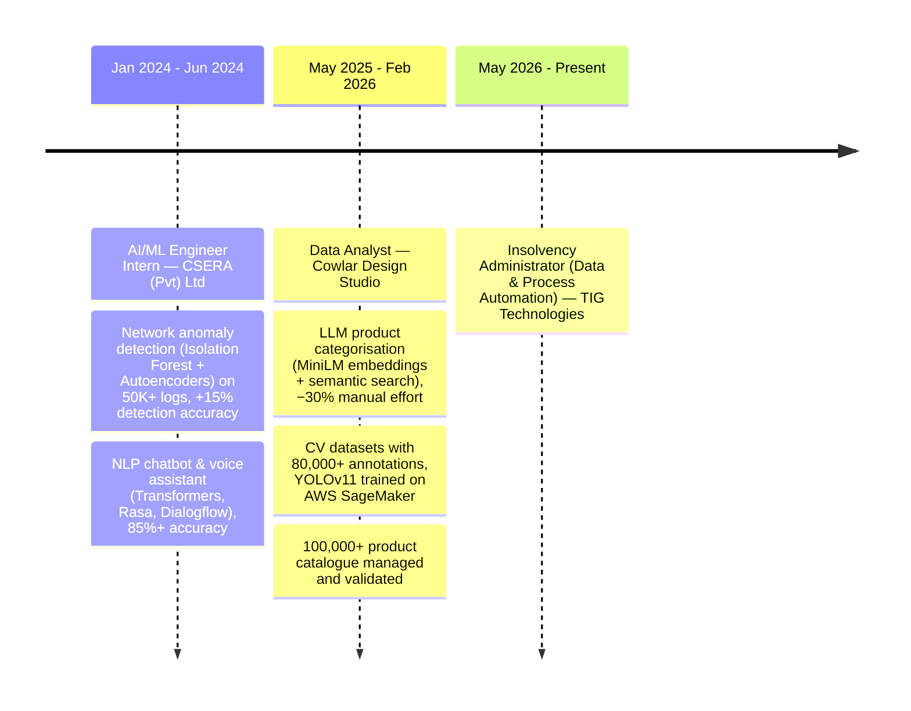
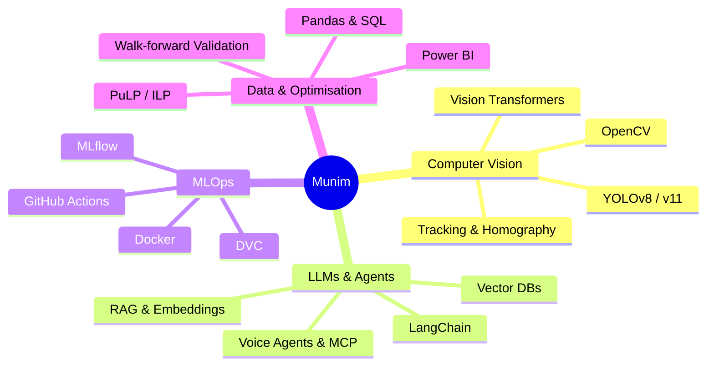

<div align="center">


<a href="https://munimakbar.vercel.app">
  
</a>

<br/><br/>

<a href="https://munimakbar.vercel.app">
  
</a>

<p>
  
  
  
  
</p>

</div>

---

## `whoami`

```python
class MunimAkbar:
    role       = "AI/ML Engineer"
    location   = "Islamabad, PK 🇵🇰"
    education  = "BS Artificial Intelligence — Air University (2021–2025)"

    focus = ["Computer Vision 👁️", "LLMs & Agentic AI 🤖", "MLOps ⚙️", "Sports Analytics ⚽"]

    pipeline = "data → features → training → evaluation → deployment → monitoring"

    def now(self):
        return {
            "shipping": "Vantage Analytics — an AI managing a real FPL squad, live all season",
            "learning": "Agentic AI (CrewAI, tool use, MCP) & production deployment",
            "open_to":  "AI/ML & Data roles — Remote | On-site",
        }
```

---

## 🚀 Featured Projects

<table>
<tr>
<td width="50%" valign="top">

### ⚽ AI-Powered Football Match Analysis
<sub>**Final Year Project** · Computer Vision</sub>

`YOLOv8` `SigLIP` `UMAP` `KMeans` `OpenCV` `FastAPI`

Detects and tracks **players, goalkeepers, referees and the ball** (4 classes), splits teams with SigLIP embeddings + UMAP + KMeans, and projects the pitch via homography for radar, Voronoi and ball-trajectory views.

**~86% accuracy** · 🔒 private repo · demo on request

</td>
<td width="50%" valign="top">

### 📈 [Vantage Analytics — AI FPL Engine](https://github.com/MunimAkbar/vantage-analytics-fpl)
<sub>**🟢 Live 2026-27 season** · Optimisation · ML</sub>

`Ridge` `PuLP (ILP)` `Pandas` `FPL API` `Walk-forward CV`

A leak-free pipeline managing a **real FPL squad for 38 gameweeks** against a human manager. Expected-points model + integer linear programming for squad, XI, captaincy and transfers, with immutable pre-deadline decision locks.

**Test MAE 1.06** (−29% vs baseline)

</td>
</tr>
<tr>
<td width="50%" valign="top">

### 📞 AI Voice Receptionist — Sara
<sub>Voice AI · Agents</sub>

`LiveKit Agents` `Deepgram` `GPT-4o` `Cartesia` `n8n MCP`

Inbound phone receptionist that books, looks up, reschedules and cancels appointments entirely by voice. STT (Deepgram Nova-3) → LLM (GPT-4o) → TTS (Cartesia Sonic-3) on LiveKit Cloud, with Google Calendar + Sheets tools via an n8n MCP server. Deployed on Railway.

</td>
<td width="50%" valign="top">

### 🫁 [Pneumonia Detection with ViT](https://github.com/MunimAkbar/Chest-X-ray-Pneumonia-Detection-with-ViT)
<sub>Medical Imaging · MLOps</sub>

`ViT` `ResNet-50` `DVC` `MLflow` `GitHub Actions` `Gradio`

ResNet-50 out-of-distribution filter in front of a Vision Transformer classifier, in a CI/CD pipeline with DVC + MLflow and a Gradio app backed by MongoDB.

**94% accuracy**

</td>
</tr>
<tr>
<td width="50%" valign="top">

### 🧠 [Kidney Disease Classification](https://github.com/MunimAkbar/Kidney-Disease-Classification-Deep-Learning-Project)
<sub>Deep Learning · MLOps</sub>

`VGG16` `DVC` `MLflow` `DagsHub` `Docker` `FastAPI`

VGG16 transfer learning on kidney CT scans with feature-space OOD detection. Dockerised FastAPI service on Hugging Face Spaces.

**92% accuracy**

</td>
<td width="50%" valign="top">

### 🎙️ [Audio-to-Image Generation](https://github.com/MunimAkbar/Audio-to-Images-LLM-System)
<sub>Multimodal GenAI</sub>

`Whisper` `Llama 3.2` `Stable Diffusion` `PyTorch` `FastAPI`

Speech → Whisper transcription → Llama 3.2 prompt expansion → Stable Diffusion image synthesis, behind a FastAPI endpoint.

</td>
</tr>
</table>

---

## 🗂️ Career Log



---

## 🧭 Skill Map



---

## 🛠️ Tech Arsenal

<div align="center">

**Core ML & AI**<br/>

&nbsp;


<br/><br/>**LLMs & Agentic AI**<br/>


<br/><br/>**MLOps & Deployment**<br/>

&nbsp;


<br/><br/>**Data, Cloud & Tools**<br/>

&nbsp;


</div>

---

## 📊 GitHub Analytics

<div align="center">


</div>

---

## 🎓 Education & Certifications

**BS Artificial Intelligence** — Air University, Islamabad · *2021 – 2025*

<details>
<summary><b>📜 Certifications (8)</b></summary>
<br/>

| Certification | Issuer | Date |
|:--|:--|:--|
| The Data Science Course | 365 Careers | May 2025 |
| YOLOv8: Video Object Detection with Python | Udemy | Nov 2024 |
| Supervised Machine Learning: Regression and Classification | DeepLearning.AI | Jan 2024 |
| Python Project for Data Science | Coursera | Jul 2023 |
| 100 Days of Python | Udemy | Jun 2023 |
| Python for Data Science, AI and Development | Coursera | May 2023 |
| Certified Python Elementary Programmer | Python Career Trainers | Apr 2023 |
| Introduction to Data Analysis | Coursera | Apr 2023 |

</details>

---

## 💬 Let's Connect

<div align="center">

<a href="https://munimakbar.vercel.app"></a>
<a href="mailto:munimakbar113@gmail.com"></a>
<a href="https://www.linkedin.com/in/munim-akbar/"></a>
<a href="https://www.kaggle.com/munimakbar"></a>

<br/><br/>

*⭐ Open to AI/ML & Data opportunities — Remote | On-site*

<br/>


</div>
